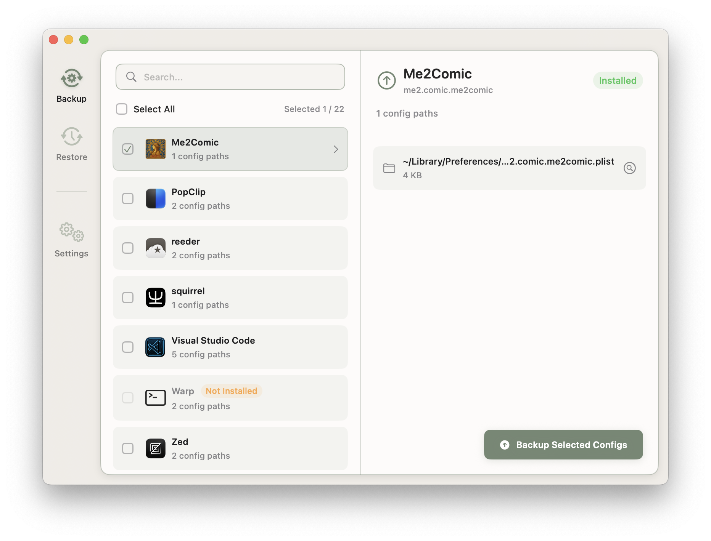
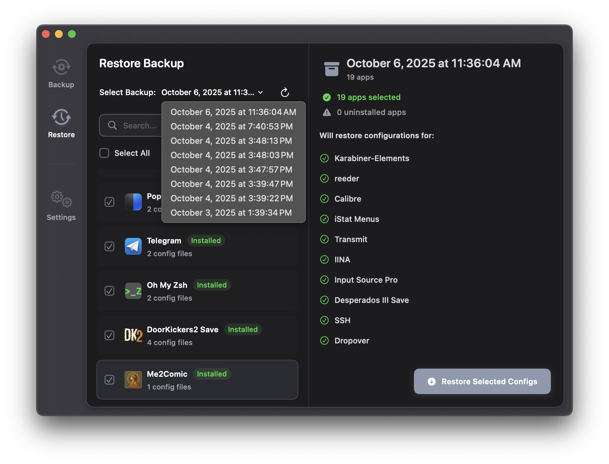
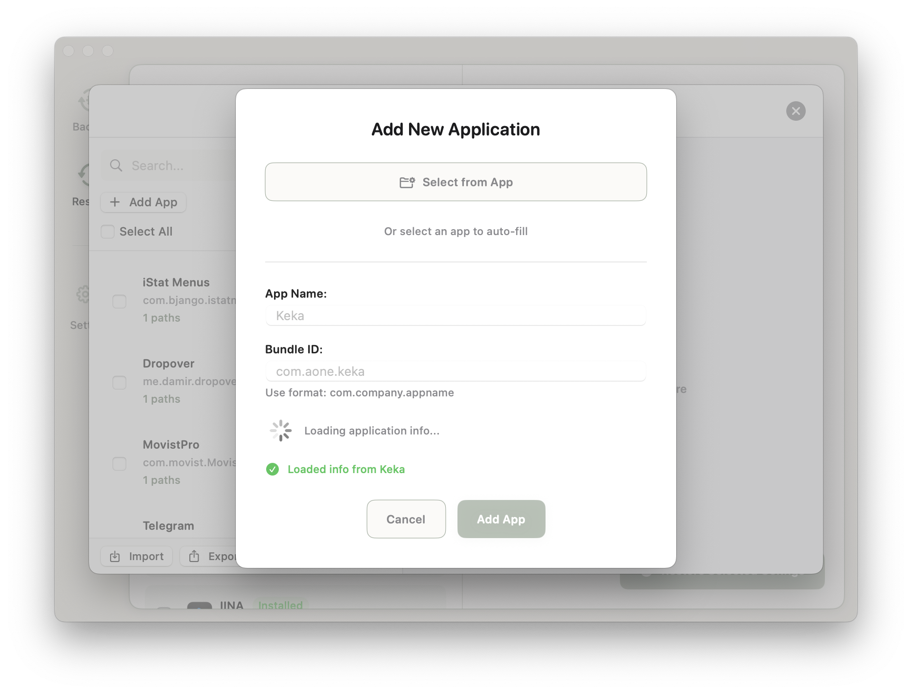
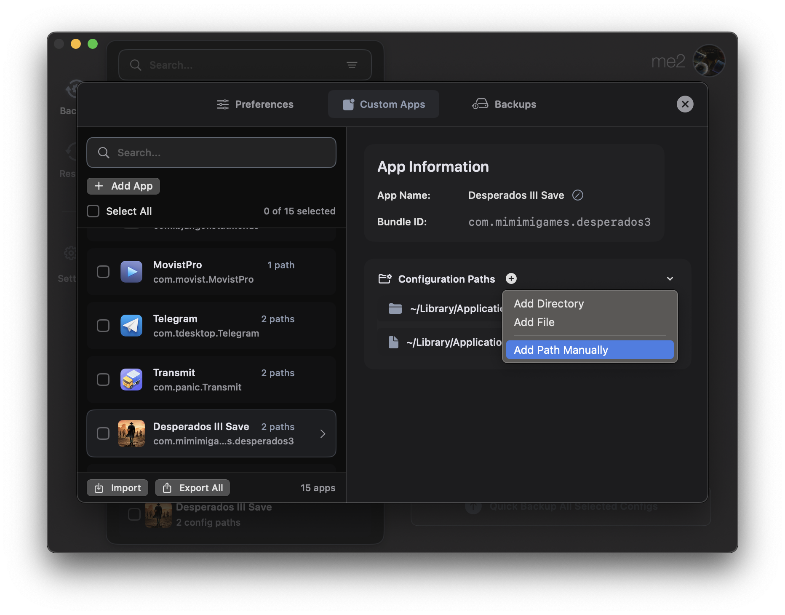

# PocketPrefs

[English](README.md) | [中文](docs/README_zh.md)

PocketPrefs is a configuration management tool for macOS applications. It enables users to easily back up, restore, and manage application configurations and data, simplifying setup when migrating to a new device or reinstalling macOS.

  
  

  
  

💡 Besides app settings, you can back up any file via custom paths.

## Features

- Backup and restore macOS application configurations and specified data
- Add and manage custom application configuration paths
- Import and export custom application configuration lists
- Incremental backup mode support

## 📦 Configuration Sharing

Here's my custom configs JSON (importable): <a href="https://github.com/DawnLiExp/PocketPrefs/discussions/1" target="_blank">discussion</a>

## Data Security ⚠️

PocketPrefs copies each backed-up file or directory to a temporary location on the destination volume before replacing the live configuration. If the copy fails, the existing configuration and its previous backup stay in place. The result lists paths that could not be restored.

With **Create old-config backup before restore** enabled, a successful replacement keeps the preceding version beside the restored item. For example, the previous `settings.json` is kept as `settings.json.pocketprefs_backup`, and a directory named `User` is kept as `User.pocketprefs_backup`. Each successful replacement with this option enabled refreshes that copy.

## System Requirements

- macOS 14+

## Building

- Xcode 16+
- Swift 6
