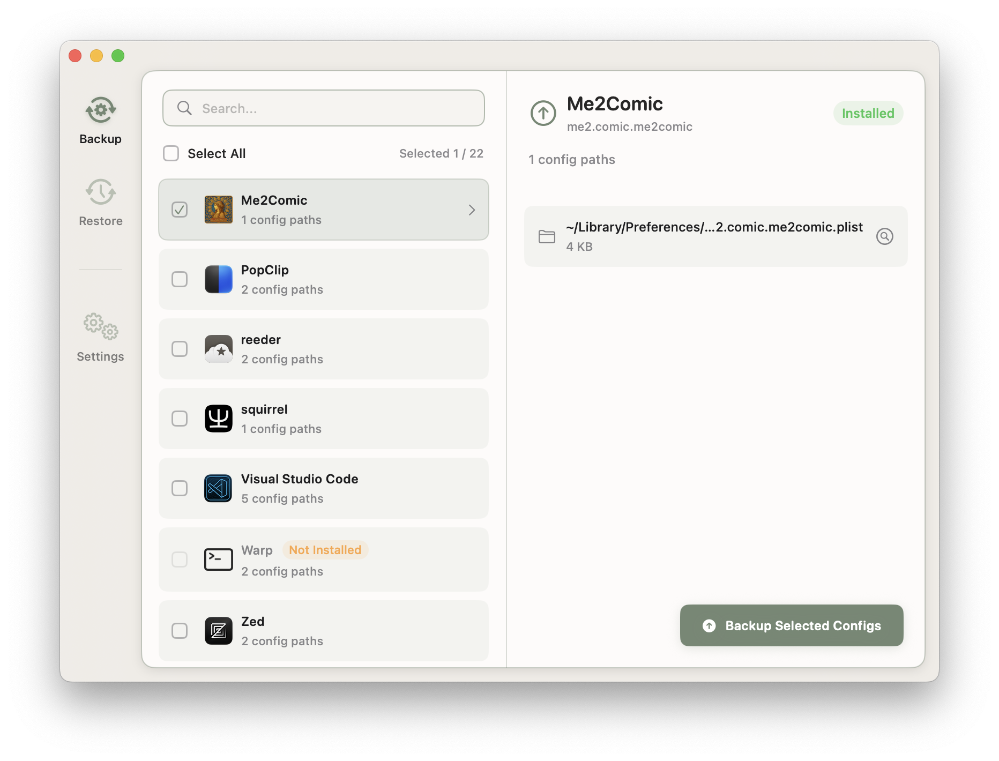
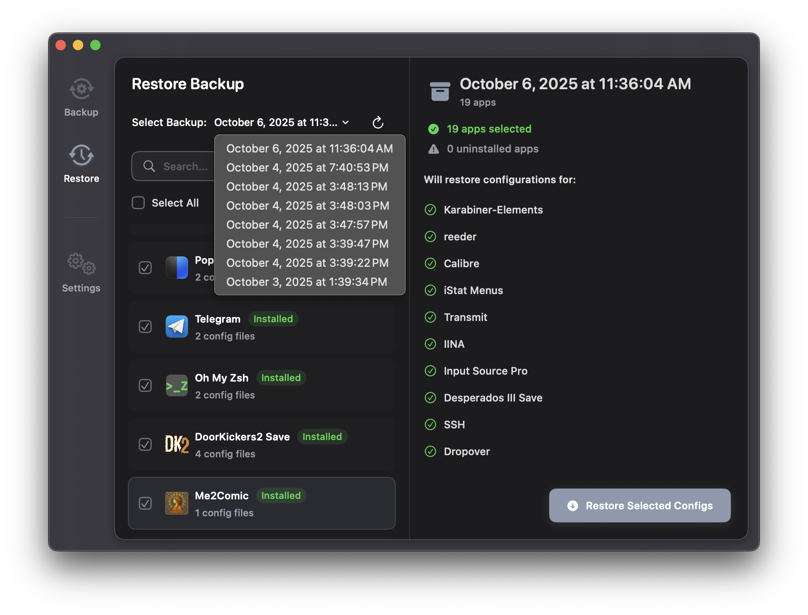
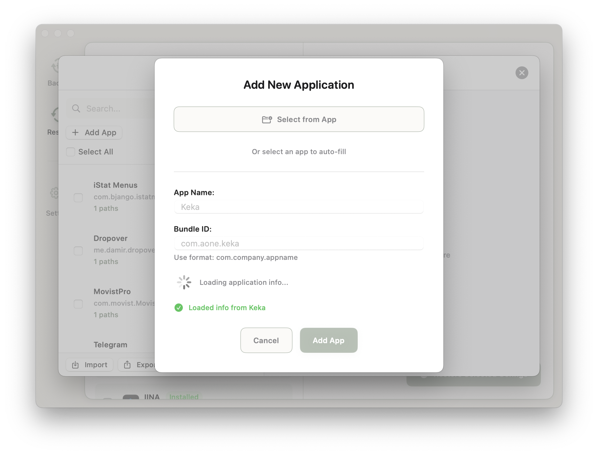
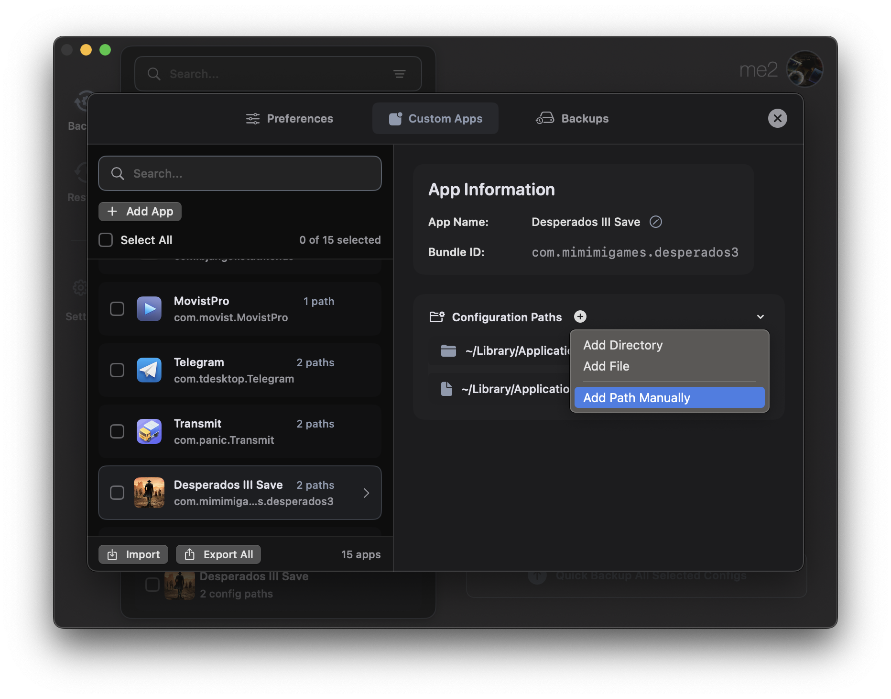

# PocketPrefs

[English](../README.md) | [中文](README_zh.md)

PocketPrefs 是一款 macOS 下的应用程序配置管理工具。它允许用户轻松备份、恢复和管理应用程序的配置文件及数据，简化在新设备或重装系统后的配置过程。

  
  

  
  

💡 灵活使用，除了软件配置，你也可以通过自定义路径备份任意文件。

## 功能特性

- 备份和恢复 macOS 应用程序的配置与指定数据
- 添加并管理自定义应用程序的配置路径
- 导入 / 导出自定义的应用程序配置列表
- 可选支持增量备份模式

## 📦 配置文件分享

个人使用的一些app自定义配置路径，可导入: <a href="https://github.com/DawnLiExp/PocketPrefs/discussions/1" target="_blank">discussion</a>

## 数据安全 ⚠️

恢复时，PocketPrefs 先将每个文件或目录完整复制到目标磁盘的临时位置，再替换现有配置。复制失败时，原配置和上次副本保留在原处，结果页会列出未能恢复的路径。

启用“恢复前备份旧配置”后，替换成功时会在原路径旁保留上一版。例如，原有的 `settings.json` 会保存在 `settings.json.pocketprefs_backup`，`User` 目录则保存在 `User.pocketprefs_backup`。每次启用该选项并成功替换时，都会更新这份副本。

## 系统要求

- macOS 14+

## 构建

- Xcode 16+
- Swift 6
